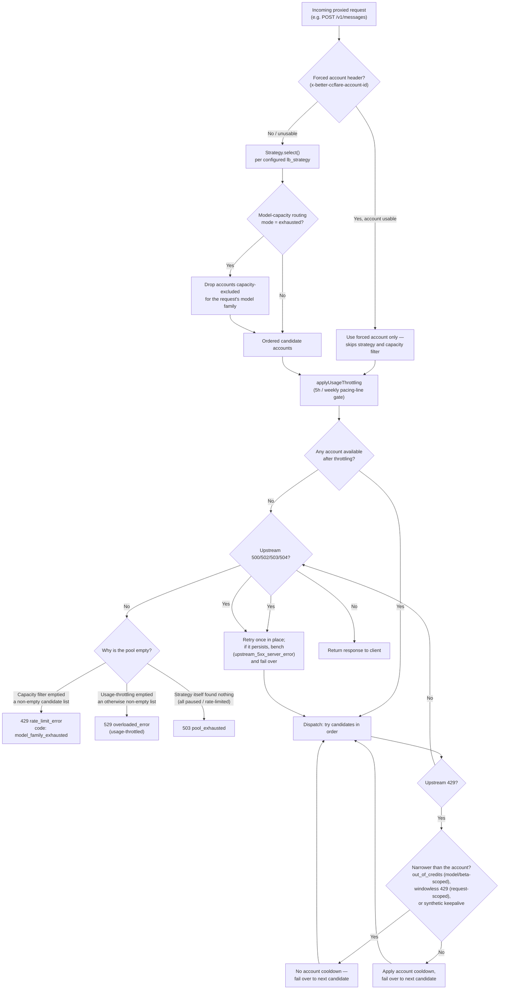
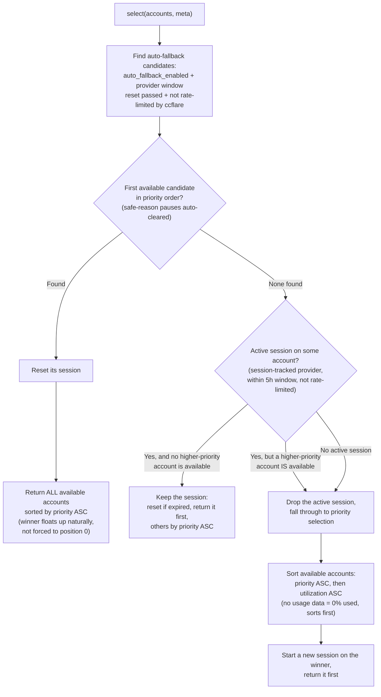
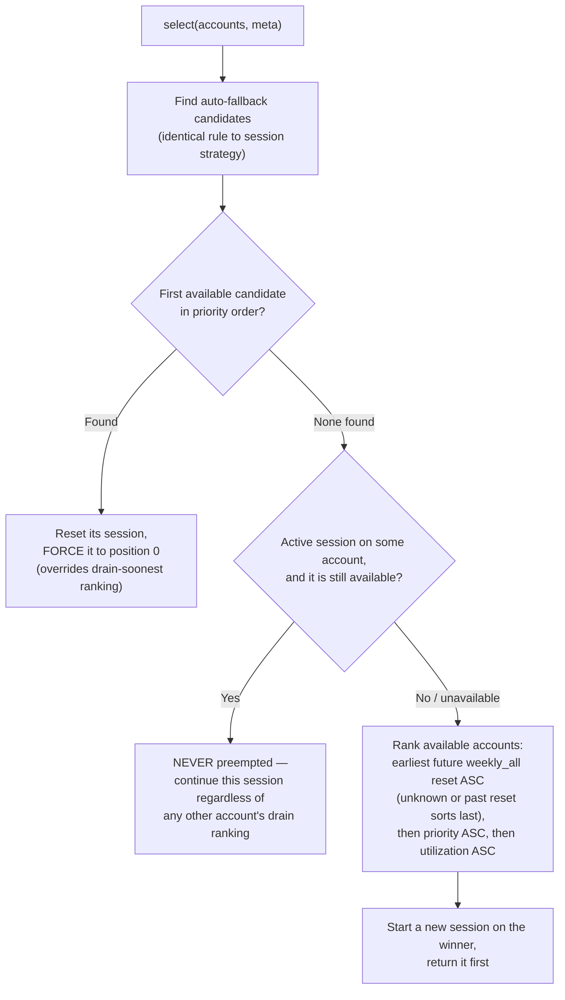
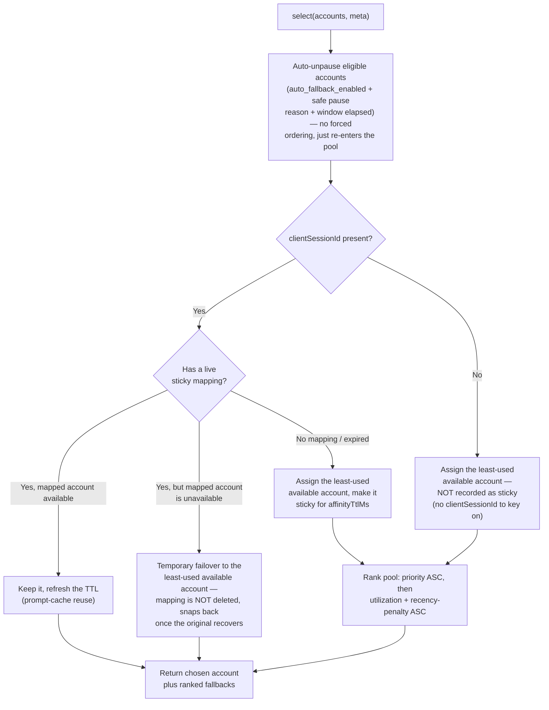
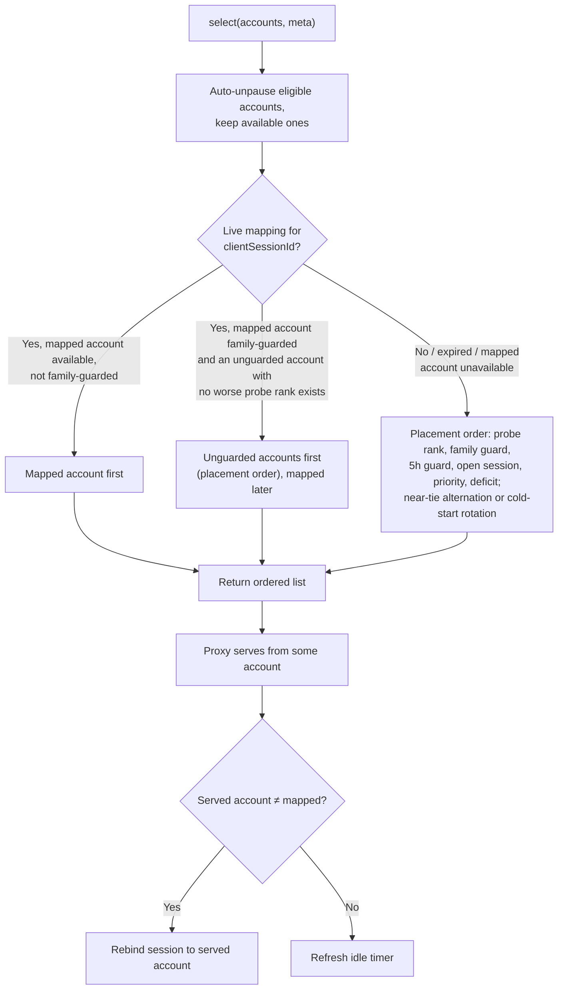
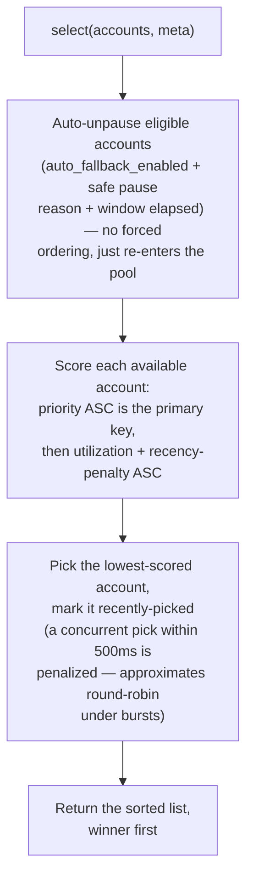
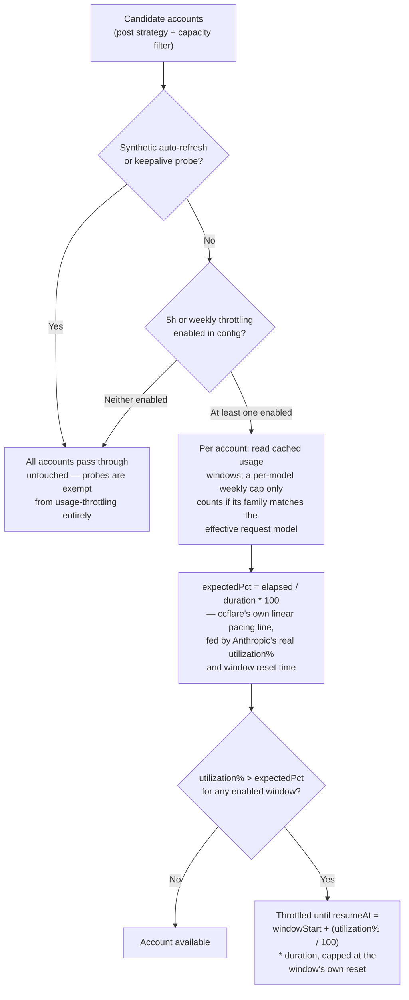
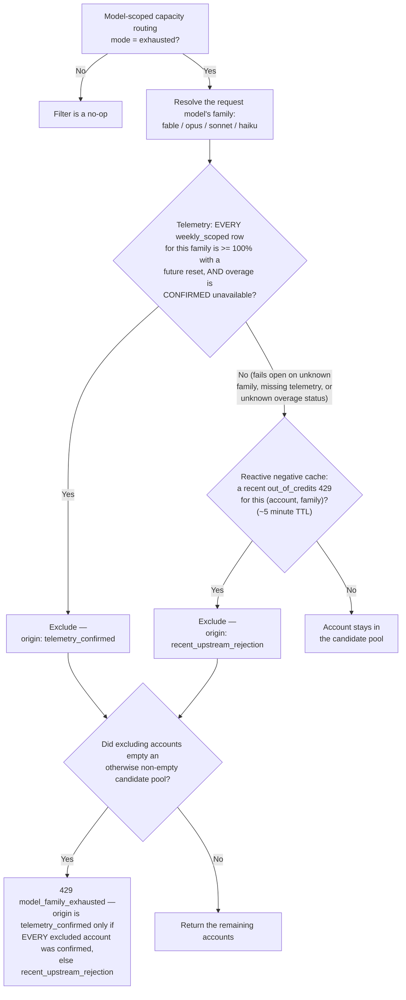
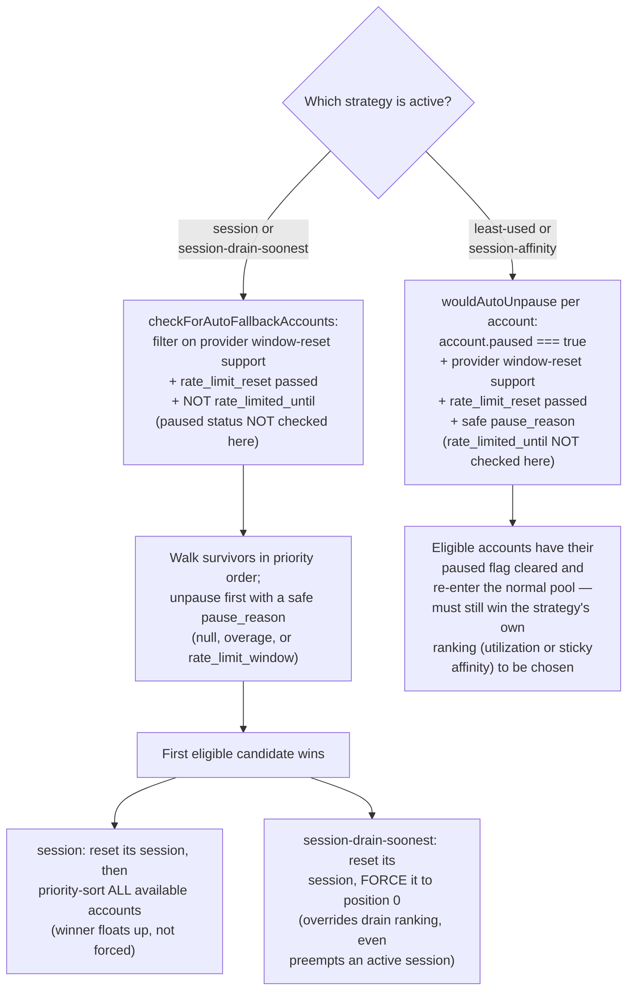

# Account Routing Architecture

This document explains how better-ccflare picks an account for each proxied request: the master pipeline, the load-balancing strategies, usage-throttling, model-scoped capacity routing, and auto-fallback. It is a technical reference for understanding *why* a given request landed on a given account — for user-facing setup guides see [Load Balancing](./load-balancing.md), [Auto-Fallback Configuration](./auto-fallback.md), [Combos](./combos.md), and [Configuration](./configuration.md).

## Table of Contents

1. [Overview: Three Orthogonal Axes](#overview-three-orthogonal-axes)
2. [Master Pipeline](#master-pipeline)
   - [Unserved /api paths](#unserved-api-paths)
3. [The Load-Balancing Strategies](#the-load-balancing-strategies)
   - [session](#session-sessionstrategy)
   - [session-drain-soonest](#session-drain-soonest-sessiondrainsoonestrategy)
   - [session-drain-soonest-strict](#session-drain-soonest-strict-sessiondrainsooneststrategy-in-strict-mode)
   - [session-affinity](#session-affinity-sessionaffinitystrategy)
   - [session-pace](#session-pace-sessionpacestrategy)
   - [least-used](#least-used-leastusedstrategy)
4. [Usage Throttling](#usage-throttling)
5. [Model-Capacity Routing](#model-capacity-routing)
6. [Auto-Fallback](#auto-fallback)
7. [Interruption Forecast](#interruption-forecast)

## Overview: Three Orthogonal Axes

Account routing is controlled by three independent settings that can each be changed at runtime without restarting the server: the **load-balancing strategy** (`lb_strategy` — which of the strategies below picks the candidate order), **usage-throttling** (`usage_throttling_five_hour_enabled` / `usage_throttling_weekly_enabled` — an optional pacing gate applied after strategy selection), and **model-scoped capacity routing** (`model_scoped_capacity_routing` — `off` or `exhausted`, an optional per-model-family exclusion filter). Any runtime "combination" you observe (e.g. `least-used` with weekly throttling and capacity routing both on) is not a special combined mode — it is simply the master pipeline below with the configured strategy plugged into the `Strategy.select` step, and the two optional gates turned on or off. Understanding the pipeline once is enough to reason about every valid combination of the three settings.

## Master Pipeline

Every proxied request first checks for the `x-better-ccflare-account-id` force-route header (used both for manual force-routing and by internal auto-refresh/keepalive probes), then runs the configured strategy's `select()`, then an optional model-capacity filter, then an optional usage-throttling gate. If the candidate pool is empty afterwards, the response depends on *why* it emptied — the capacity filter and usage-throttling empty the pool for mutually exclusive reasons on a given request (the capacity filter runs first and, if it excludes everyone, usage-throttling never sees any accounts to throttle), so the code checks them in a fixed priority order: a capacity exclusion is reported first (as a structured 429), a throttling exclusion second (as a 529), and a strategy-level "nothing available at all" last (as a generic 503). When a [Combo](./combos.md) is active for the request's model family, an additional per-slot routing layer runs between the forced-header check and `Strategy.select`; it is omitted from the diagram below for clarity (see `packages/proxy/src/handlers/account-selector.ts`).

Three classes of 429 are narrower than the account and therefore fail over per
request with the account left in rotation — no cooldown, no
`consecutive_rate_limits` increment:

- **`out_of_credits`** — credits/overage depleted for one model or beta (e.g. context-1m); the account's other models still work.
- **`windowless_429`** — `x-should-retry: true` with no rate-limit metadata at all (no `retry-after`, no `anthropic-ratelimit-*` / `x-ratelimit-*` header). Measured on a production install as **request**-scoped: the same account served 200s two seconds before and 38 seconds after on the same model, retries spanning 11.2s returned identical bare 429s without ever clearing, and the next account rejected the same client request the same way. Benching for it drained the pool one account per failover attempt. The check is fail-closed — any header that reports window state, known name or not, is treated as a real limit and benched as before.
- **Synthetic keepalive replays** — the keepalive scheduler's own parallel burst trips a per-IP limit; no request-history row is written either.

A transient upstream server error — HTTP **500/502/503/504** from any provider
— is neither a quota signal nor narrower than the account, so it gets its own
treatment: the request is re-issued once on the same account, and if the error
survives that the account is benched under `upstream_5xx_server_error` and the
request fails over. The bench is `CCFLARE_SERVER_ERROR_COOLDOWN_MS` (60s) or a
shorter upstream `Retry-After`, never ramps, and leaves
`consecutive_rate_limits` untouched — the account's own quota is fine, the
provider (or the organization behind the account) is not. On the last candidate
account the real upstream response is forwarded instead of a synthetic
`pool_exhausted`. Set `CCFLARE_SERVER_ERROR_RETRY_ENABLED=false` to forward
these straight to the client again.

A 429 from the last candidate is not forwarded that way under most
strategies: it fails over like any other 429 and the request ends in the local
`pool_exhausted` 503. Under `session-pace` (any strategy with the all-limited
rule, see [below](#session-pace-sessionpacestrategy)) the proxy keeps the most
recent upstream limit refusal of the request (account-wide, all models
exhausted, `out_of_credits`, windowless; at most 64 KiB of body) instead of
draining it. When every candidate has refused, it asks the all-limited rule
which account becomes usable first, now that this request's refusals have set
their cooldowns. If that is the account whose refusal it holds, the client gets
that refusal; otherwise the proxy sends the request once more to that account
and the client gets whatever it answers, or the held refusal if it gives no
response. Either way the client sees a genuine upstream status, body and
headers (minus `content-encoding`, `content-length` and `transfer-encoding`,
which every proxied response loses because the body is already decoded, plus
`x-better-ccflare-request-id`). Combo routes keep today's behaviour.

The `windowless_429` exemption is not universal: it is evaluated only on the
no-fallback path (the requested model has no multi-entry mapping). An account
**with** multi-entry model mappings walks its fallback list first, and when every
mapped model has 429ed the request ends at `all_models_exhausted_429`, which
**does** apply an account cooldown — even if each individual 429 reported no
window.

*Source: `packages/proxy/src/proxy.ts` (`handleProxy`, `applyUsageThrottling`), `packages/proxy/src/handlers/account-selector.ts` (`selectAccountsForRequest`), `packages/proxy/src/handlers/proxy-operations.ts` + `packages/proxy/src/handlers/retryable-429.ts` (the three no-bench 429 classes and the transient-5xx retry/bench path).*

### Unserved /api paths

A path the API router does not serve normally falls through to the proxy and goes upstream with an account's token. For `/api` and `/api/...` (prefix matched case-insensitively) the server stops that: an unserved path gets a local JSON `404` (`not_found_error`), with no account selection and no upstream request. Three exact paths that the Claude CLI sends still pass through to the proxy as before: `/api/hello` (the CLI's connectivity check, forwarded upstream) and `/api/event_logging/batch` and `/api/system/package-manager` (answered locally by the proxy's stub). Each refusal is logged at WARN as `Refused unserved API path: <METHOD> <path>`, at most once per method and path per minute, with a `suppressedSinceLastLog` count. If a CLI feature stops working and that line names a path the CLI needs, add the path to `PROXY_PASSTHROUGH_API_PATHS`.

*Source: `apps/server/src/api-guard.ts`, called in `apps/server/src/server.ts` right after `apiRouter.handleRequest`.*

## The Load-Balancing Strategies

`lb_strategy` selects one of the implementations in `packages/load-balancer/src/strategies/` (all constructed in `apps/server/src/server.ts`; the two drain-soonest entries share one class in different modes). All of them return an ordered list of candidate accounts; the first entry is tried first, the rest are failover order.

### session (SessionStrategy)

The default strategy pins a client to one account for the configured session duration (5h by default) so prompt caches stay warm, and only rotates to a new account once that session expires, the account becomes unavailable, or a higher-priority account frees up. Unlike the drain-soonest variant below, an active session *can* be preempted — but only by a strictly higher-priority account, never by a same-or-lower-priority one. Auto-fallback candidates are checked first on every call; if one becomes eligible, its session is reset but it is not force-ranked to the top — it is simply included in a fresh priority-sorted list, avoiding a priority inversion if an even-higher-priority account is already available.

*Source: `packages/load-balancer/src/strategies/index.ts` (`SessionStrategy.select`, `checkForAutoFallbackAccounts`).*

### session-drain-soonest (SessionDrainSoonestStrategy)

This strategy shares session-affinity and auto-fallback semantics with `session`, but replaces the static-priority tiebreak with a "use it or lose it" ranking: at every fresh selection it prefers whichever account's `weekly_all` usage window resets *soonest*, so unused weekly capacity is drained before it is replaced by a fresh, unrelated allowance. The one deliberate exception is its whole purpose — an active session is **never** preempted by drain ranking, only by auto-fallback reactivation, which is force-ranked to position 0 (unlike `session`, which never forces a position).

*Source: `packages/load-balancer/src/strategies/session-drain-soonest.ts`.*

Caveat of the default ("sticky") mode: with several concurrently active
sessions — the production-normal state, since served requests, keepalive
probes, and the usage-poller rollover callback all open sessions — the
"active session" check resolves to the account with the MOST RECENT
`session_start`, and that account holds all traffic until another account
receives a fresher write. The drain ranking then only orders the failover
tail.

### session-drain-soonest-strict (SessionDrainSoonestStrategy in strict mode)

The same strategy class constructed in `"strict"` mode (`StrategyName.SessionDrainSoonestStrict`). Instead of the active-session pre-filter, one canonical comparator ranks every *available* account:

1. earliest future `weekly_all` reset (unknown or past reset sorts last),
2. active-session status — an active 5h session breaks reset ties but never pins an account,
3. priority ASC,
4. utilization ASC,
5. account id (determinism anchor, so equal candidates never depend on input order).

Consequences: the drain-earliest account keeps winning even after its own 5h window ages out (it gets a fresh session on selection — no lock-out), and in the cold-cache case (all weekly resets unknown, e.g. right after a restart) the incumbent active account keeps the traffic instead of utilization-ranked spraying. The auto-fallback exception and the bypass header behave identically in both modes; behind a forced fallback the tail follows the strict comparator, so the failover loop always walks one consistent order.

An account whose weekly window was reset *out-of-band* by Anthropic (usage back to 0% while ccflare's own `rate_limit_reset` still holds a stale future timestamp from an earlier 429) would otherwise rank last here indefinitely — "unknown reset sorts last" combined with a stale `rate_limit_reset` blocking the auto-refresh probe gate created a permanent starvation deadlock ([#443](https://github.com/tombii/better-ccflare/issues/443)). The usage poller now detects this contradiction and clears the stale `rate_limit_reset` so the account is probed on the next auto-refresh tick and re-enters ranking with a real reset time — see [auto-refresh.md](auto-refresh.md#out-of-band-reset-detection).

### session-affinity (SessionAffinityStrategy)

A hybrid of `session` and `least-used`, keyed on the *client's* session id (the request body's `metadata.user_id`) rather than a single account-level session: the first request from a new client is routed to the least-loaded account, and that client→account mapping then stays sticky for `affinityTtlMs`. This spreads many concurrent client-sessions across the whole pool (instead of `session`'s single account taking all traffic until it rate-limits), while each individual client still keeps its prompt-cache locality. A request with no `clientSessionId` at all is still routed to the least-used account, but since there is no client id to key on, no sticky mapping is recorded for it — the next such request is scored fresh. Auto-fallback here only auto-*unpauses* eligible accounts so they re-enter the pool — it never forces a pick, unlike `session`/`session-drain-soonest`.

*Source: `packages/load-balancer/src/strategies/session-affinity.ts`.*

### session-pace (SessionPaceStrategy)

Per-client-session stickiness keyed on `metadata.user_id` (the whole string, as `session-affinity` keys it), with a placement rule built around the weekly allowance. A new session goes to the available account furthest behind an even spend of its all-models weekly window (`seven_day`, else the `weekly_all` entry of `limits[]`):

- `windowStart = resets_at − 7 days`, `elapsedPct = clamp(workTime(windowStart, now) / workTime(windowStart, resets_at) × 100, 0, 100)`, `deficit = elapsedPct − utilization`. `workTime(a, b)` is the time between `a` and `b` that falls on a work day: a local calendar day whose ISO weekday is at most `session_pace_work_days` (default 5, Monday to Friday), so the even-pace marker stands still over the weekend. Days run from local midnight to local midnight in the machine's time zone (read once when the strategy is built, from `TZ` or else the system zone), so a 23- or 25-hour day around a DST change counts its real length. With `session_pace_work_days = 7` this is the calendar share of the week. A window with no work time at all falls back to the calendar share. An account without weekly data has deficit 0. A reset that has already passed is not special-cased: elapsedPct clamps to 100 until the next usage poll brings the new window.
- Every placement, failover, family-guard and rebind log line names the pace basis as `work_days=<N> tz=<zone>`.
- Placement order, highest first: availability; probe-backoff rank; the **model-family guard**; the **5-hour guard**; the **open-session rule**; configured priority; deficit (largest first); near-tie alternation.
- **5-hour guard**: an account whose `five_hour` utilization is at or above `session_pace_five_hour_guard_pct` (default 90) ranks behind accounts below it. A figure whose reset has passed does not guard. If every candidate is guarded the guard changes nothing. It applies only to new placements; a mapped session stays.
- **Open-session rule**: an account with no running 5-hour window ranks ahead of the rest of its tier, so the next new session opens a window there and every account keeps a 5-hour window ticking. No window running means usage data for the account is present and its 5-hour window (`five_hour`, else the `session` entry of `limits[]`) has no reset time or a reset time that is not in the future; an account without usage data, or whose data has no 5-hour window (every provider other than Anthropic and Codex), is not affected. The rule sits below availability, the probe-backoff rank and both guards, and above configured priority and deficit. It applies to first placements, re-placements after the idle time and family-guard moves; a session with a usable mapping does not move. One placement is enough: once the strategy places a session on such an account, or the account serves a response, the rule leaves that account alone for 120 s (`SESSION_PACE_OPEN_SESSION_HOLD_MS`). The strategy cannot see when usage data was fetched; with the default 90 s ±20% poll the data has usually been refreshed by then (a longer configured interval, a slow fetch or a failure backoff can leave it older), and the rule applies again only if the data still shows no window. A family-guard move onto such an account holds it the same way. Several accounts without a window are ordered among themselves by the rest of the order, and each placement holds one of them, so consecutive new sessions open one window each. The placement line then reads `rule=open-session reason=no-five-hour-window`, and each candidate shows `5h=<n>%` (running), `5h=not-running` (with `open-held` while held) or `5h=unknown`. A request without a client session id is placed afresh every time and logs nothing, except when this rule decides it (`session=none`).
- **Model-family guard**: the request's model is resolved to a family with `getModelFamily` (`fable`, `opus`, `sonnet`, `haiku`, by substring; anything else is unguarded). An account whose `weekly_scoped` row for that family is at or above `session_pace_family_guard_pct` (default 90), with a future reset, ranks behind accounts below the guard: guarded accounts are demoted, not removed, so failover still has somewhere to go. Among guarded accounts the lowest family utilization comes first. A mapped session on a guarded account is ordered onto an unguarded account whose probe-backoff rank is no worse; the mapping moves when that account serves (below). If every candidate is guarded, a mapped session stays where it is. Pace is never computed on a model-scoped window.
- **Near-ties**: when the two leading candidates in the same tier have deficits within `session_pace_tie_band_pct` (default 10) and the leader was picked within the last 500 ms, the runner-up takes the new session. Outside the band every new session goes to the leader.
- **Cold start**: when no candidate has weekly or 5-hour data, new sessions rotate through the leading tier, least recently picked first.
- **Rebind after failover**: the proxy calls `strategy.onRequestServed(meta, account, status)` once it has committed to an account's response (`packages/proxy/src/proxy.ts`, `recordServedAccount`). If a request this strategy routed was served (2xx/3xx) by an account other than the session's mapped one, the session rebinds to it and does not return. Requests that never reach `select()` (force-routed by `x-better-ccflare-account-id`, combo slots) never rebind.
- **Idle expiry**: a mapping expires after `session_pace_idle_ms` (default 1 hour, the prompt-cache lifetime) without a request; the next request is placed fresh.
- The paid extra-usage pool plays no part in the ranking.
- **All accounts limited**: when a request has no account only because every account that could serve it is out on a limit (provider cooldown, exhausted 5-hour or weekly window, or, with `MODEL_SCOPED_CAPACITY_ROUTING=exhausted`, the requested family's exhausted window), the proxy does not compose `503 pool_exhausted` or `429 model_family_exhausted`. It forwards the request to the account that becomes usable first: per account, the latest reset among the limits blocking it; an unknown reset sorts last; ties go to the lower priority number, then the name. The client receives that account's own upstream response unchanged, normally Anthropic's limit refusal with its real reset, or a success if the usage data was stale. Paused accounts, accounts needing re-authentication and accounts excluded for other reasons are never targets; with none left the local error stays. The rule applies to new, mapped and session-less requests alike and does not rewrite mappings. It applies to every request class as well: messages and `count_tokens` with a model (with `MODEL_SCOPED_CAPACITY_ROUTING=exhausted` too, where the strategy already left no candidate before the family filter ran), `HEAD /api/hello`, and requests made before any usage data is loaded, which then rank on cooldowns alone. Each such request makes one upstream attempt, or two when that account's refusal leaves another account usable sooner. It logs `session-pace place … rule=all-exhausted reason=earliest-reset` with every candidate's usable-again time and blocking limits. A 429 from an account chosen this way sets its cooldown from the response but leaves `consecutive_rate_limits`, the backoff ramp and the circuit breaker alone, so repeated refusals do not delay the account once its reset passes. Forced-account requests (`x-better-ccflare-account-id`), `x-better-ccflare-bypass-session` probes and combo routes are outside the rule. `CCFLARE_PASSTHROUGH_ON_EMPTY_POOL` is reached only when the rule finds no target. If accounts that looked available all refuse for limits during the request, the proxy answers with a genuine upstream refusal too (see [Master Pipeline](#master-pipeline)).

Usage figures come from the usage cache, refreshed by the usage poller every `usage_poll_interval_ms` (default 90 s, ±20% jitter); a cached entry expires after 10 minutes without a successful poll. Response headers on proxied Anthropic requests do not update this cache.

*Source: `packages/load-balancer/src/strategies/session-pace.ts`.*

### least-used (LeastUsedStrategy)

The simplest strategy: no session stickiness at all, every request independently picks the account with the lowest effective utilization (upstream utilization plus a short recency penalty so concurrent bursts spread across the pool instead of piling onto the same "emptiest" account). It trades prompt-cache reuse for better burst tolerance — a spike of N concurrent requests is spread across all healthy accounts rather than funneled into one, reducing the chance of several accounts hitting per-account rate limits at once. Like `session-affinity`, its auto-fallback handling only auto-unpauses eligible accounts; it never forces a pick.

*Source: `packages/load-balancer/src/strategies/least-used.ts`.*

## Usage Throttling

Independent of which strategy picked the candidate order, usage-throttling (`usage_throttling_five_hour_enabled` / `usage_throttling_weekly_enabled`) can hold an account back even though it isn't rate-limited yet. For each enabled window class, ccflare computes its own linear **pacing line** — the percentage of the window's duration that has elapsed — and compares it against Anthropic's real reported utilization: if the account is "ahead of pace" it is throttled until the point where reported usage and the pacing line would realign. A per-model weekly cap only counts against the request's own model family for normal requests — but combo-routed requests assign their per-slot model later in the pipeline, so `applyUsageThrottling` passes no request model for them and model-scoped weekly windows are skipped entirely (only the flat, non-scoped windows and the reactive `out_of_credits` cache still apply). Internal auto-refresh/keepalive probes (identified by the `x-better-ccflare-auto-refresh` / `x-better-ccflare-keepalive` request headers) are exempted from this gate entirely — they exist specifically to hit the real endpoint and observe state changes (window resets, recovered accounts), and without the exemption a throttled-but-healthy account's own probe would get our own 529 back, which the auto-refresh scheduler previously misread as an endpoint failure and counted toward its consecutive-failure pause threshold.

*Source: `packages/proxy/src/handlers/usage-throttling.ts` (`getUsageThrottleStatus`), `packages/proxy/src/proxy.ts` (`applyUsageThrottling`).*

## Model-Capacity Routing

When `model_scoped_capacity_routing` is set to `exhausted`, accounts whose weekly per-model-family cap (e.g. a Fable/Opus/Sonnet-specific quota) is provably exhausted are excluded from routing for requests of that family — in both normal and combo-slot routing. Exclusion has two independent signals: a **telemetry-confirmed** one (the account's own usage payload shows every relevant weekly-scoped row at ≥100% with a future reset, and pay-as-you-go overage is confirmed unavailable) and a **reactive** one (a recently observed `out_of_credits` 429 sidelines the account for that family for a short, fixed TTL to bridge the telemetry poll interval). The filter fails open on any ambiguity — an unknown model family, missing/dropped telemetry rows, or an unresolved overage signal never causes an exclusion — because a false exclusion removes a working account while a false pass only costs one extra 429 round-trip. Only when excluding accounts empties an otherwise non-empty candidate pool does the request get the structured `model_family_exhausted` response instead of falling through to the generic pool-exhausted path.

*Source: `packages/proxy/src/handlers/model-capacity.ts` (`isAccountExhaustedForModel`, `markFamilyExhausted`), `packages/proxy/src/handlers/account-selector.ts` (`isAccountCapacityExcluded`), `packages/proxy/src/handlers/proxy-operations.ts` (the `out_of_credits` 429 handler that feeds the reactive cache — distinct from the unrelated `all_models_exhausted_429` per-account cooldown reason used when an account's own configured model-fallback list is exhausted).*

## Auto-Fallback

The same per-account `auto_fallback_enabled` flag drives two different mechanisms depending on which strategy is active, and the two mechanisms do **not** share one eligibility rule — they diverge on exactly which state an account must be in. `session` and `session-drain-soonest` run a dedicated `checkForAutoFallbackAccounts` pass: it filters candidates on provider window-reset support (Anthropic, Codex, or Zai) with `rate_limit_reset` passed AND not currently rate-limited by ccflare — deliberately checking paused status nowhere, so both paused and already-unpaused accounts can win this pass — then walks the survivors in priority order and unpauses the first one whose `pause_reason` is safe (`null`, `overage`, or `rate_limit_window` — never `manual` or `failure_threshold`), letting it float up in a fresh priority sort (`session`) or forcing it to the very front, even preempting an active session (`session-drain-soonest`). `least-used` and `session-affinity` instead only auto-*unpause* eligible accounts via the shared `wouldAutoUnpause` predicate, which requires `account.paused === true` (unlike the other pass, an already-unpaused account is simply skipped here — there's nothing to unpause) plus the same provider/window-reset/safe-pause-reason checks, but does **not** check `rate_limited_until` at all; the account re-enters the normal pool but must still win that strategy's own ranking (utilization score or sticky affinity) to actually be chosen, and neither strategy force-picks it.

*Source: `packages/load-balancer/src/strategies/peek-availability.ts` (`wouldAutoUnpause`, shared by `least-used` and `session-affinity`), `packages/load-balancer/src/strategies/index.ts` and `session-drain-soonest.ts` (`checkForAutoFallbackAccounts`, the forced-position variant).*

## Interruption Forecast

The interruption forecast projects how much pooled quota the Claude OAuth accounts have left over the rest of the day, plans when each account opens its 5-hour window and where sessions should sit so that the lowest point of that projection stays as far above zero as possible, and serves the projection at `GET /api/forecast` ([forecast-endpoint.md](./forecast-endpoint.md)). Routing under `session-pace` follows the plan; with no usable plan it behaves exactly as described in [session-pace](#session-pace-sessionpacestrategy).

### When it is computed

- After each recorded usage snapshot of a Claude OAuth account (polled every `usage_poll_interval_ms`, default 90 s), a computation starts once the polls have settled for 5 s (`FORECAST_POLL_SETTLE_MS`), and never sooner than 30 s after the previous one started (`FORECAST_MIN_SPACING_MS`).
- It runs off the request path, one at a time. Polls that arrive during a computation are coalesced into one follow-up run.
- One run: record the proxy's own served requests as demand history (after the first successful sync, when `transcriptsDir` is set, a one-time backfill from local Claude transcripts starts in the background; it reads usage metadata only and is never awaited); load the demand history and usage readings from the later of `historyLookbackDays` ago and the earliest stored demand bucket, each counted account's limits from the usage cache, and the live sessions; run the engine; keep the result; then tick the pre-warm scheduler.
- Failures are logged once per run and never reach a request. A failed demand sync does not stop the run. An engine failure replaces the kept result with the no-forecast shape, `reason: "error"`. A run that fails before the engine keeps the previous result, which then ages.
- `GET /api/forecast` only serves the kept result; it never computes.

### Fresh and stale

The kept result is **fresh** while it is available and no older than 3 poll intervals (`FORECAST_STALE_POLLS` × `usage_poll_interval_ms`, 4.5 minutes at the default). Past that, or before the first result, the endpoint answers the no-forecast shape with `reason: "error"` and routing gets no advice.

### How routing uses it

Only `session-pace` takes advice, only when `routing` is on, and only for requests that carry a client session id (requests without one are placed by the ordinary session-pace rules). Under another strategy the forecast is still computed and served for display. Advice is the first step of the plan, replanned on every run:

- **New session**: the hard filters run first as before (availability, probe back-off, the model-family guard, never an account that is out). The plan gives look-ahead tiers; the first tier that holds a candidate wins, and inside it the usual session-pace ranking decides. Under advice the 5-hour 90 % guard is a tie-break inside the tier, not a filter. The placement is logged with the usual `session-pace place` line; its `rule` and `reason` come from the advice.
- **Cold session**: a mapped session whose last request plus its cache lifetime has passed (1 hour when at least half of its cache writes were 1-hour writes, else 5 minutes; the idle setting while unknown) is placed like a new session. When it lands on another account the reason starts with `cold:`.
- **Live session**: moved only when the plan says the lowest point ends higher after paying the cold-cache re-read on the other account (the gain threshold is `moveMinGainPoints`). The target must be among the candidates, not out, and pass the family guard; otherwise the session stays. Each move is applied once per plan and logged as
  `session-pace move session=<tag> from=<name> to=<name> rule=forecast-move reason=<reason> gain=<points> cost=<points>`.
- The model-family (Fable) guard stays hard. The all-limited rule is unchanged and decides as before when every account is out.

**Fallback**: when `routing` is off, the forecast is disabled, the result is stale or missing, the engine failed, or the advisor fails, session-pace gets no advice and routes exactly as pace.3 did.

### Pre-warm

A window opening in the plan (`openAt`) means one of two things, and only `prewarm` decides which. With `prewarm` off (the default) the opening is made by routing: from the planned time the next new session is placed on that account with rule `forecast-open`, its first request opens the window, sessions already attached to other accounts stay where they are, and no pre-warm request is sent; with `prewarm` on the scheduler below opens the window itself at that time.

Pre-warm opens an account's 5-hour window at the time the plan chose, with one one-word request through the real `claude` CLI (print mode, `prewarmModel`, default Haiku) pinned to that account through the proxy. It is **off by default** (`prewarm: false`). With it on, the scheduler fires only when the forecast is fresh, the plan's opening time has come, the account has a current usage reading (the usage cache keeps a reading for at most 10 minutes) that shows no open 5-hour window, the account is counted and not out, it is below `prewarmMaxPerDay` for the day, no pre-warm ran for it in the last 5 hours, and none is running. Records of the last 20 pre-warms survive a restart. Whether the window opened is judged only from a reading that arrived after the pre-warm finished.

**Local API keys**: the pre-warm request goes through this proxy without a local API key. When the proxy has active API keys (`/api/api-keys`), it answers that request 401 and no window opens; the `done` line then shows the CLI's non-zero exit.

`prewarmTest` (`{ "account": <name or id>, "at": <time> }`) is one attempt at the first scheduler tick at or after `at`, whether or not `prewarm` is on and whether or not a forecast is available, and never twice for the same pair. It waits while the account has no current reading or a pre-warm for it is running, and it is skipped (and counted as done) when the account's 5-hour window is already open. Procedure: [packages/forecast/src/prewarm/README.md](../packages/forecast/src/prewarm/README.md#test-morning-run-by-the-supervisor-with-filip).

Log lines (INFO):

- `forecast prewarm fire account=<name> kind=<plan|test> scheduled=<iso> late=<seconds>`
- `forecast prewarm done account=<name> exit=<code|none> ms=<n>`
- `forecast prewarm result account=<name> windowOpened=<true|false> resetsAt=<iso|none>` (after the next readings)
- `forecast prewarm skip account=<name> reason=<token>` (tokens include `window_open`, `daily_cap`, `not_counted`, `stale_reading`, `unknown_account`)

`GET /api/forecast` lists the plan's window openings under `prewarm.planned` whether `prewarm` is on (made by a pre-warm request) or off (made by routing), and the recent pre-warms under `prewarm.last`.

### Settings and restarts

Settings, defaults and formats: [Forecast Settings](./configuration.md#forecast-settings). The config file is read at start, so every change applies after a restart. Two of them also decide what is built at start:

- `enabled: false` at start: nothing is constructed (no session tracking, no computation, no scheduler, no timers) and the endpoint answers `reason: "disabled"`. Turning it back on needs a restart.
- `routing: false` at start: session-pace is not given the advisor until a restart. With the advisor attached at start, every call also checks the current `enabled` and `routing` values and gives no advice when either is off.

*Source: `packages/forecast/src/service/` (computation, freshness, advisor, endpoint provider), `packages/forecast/src/prewarm/` (scheduler and runner), `packages/load-balancer/src/strategies/session-pace.ts` (advice), `apps/server/src/forecast-wiring.ts` (construction).*
